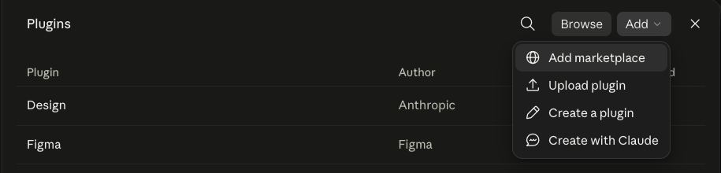
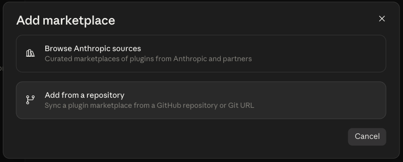
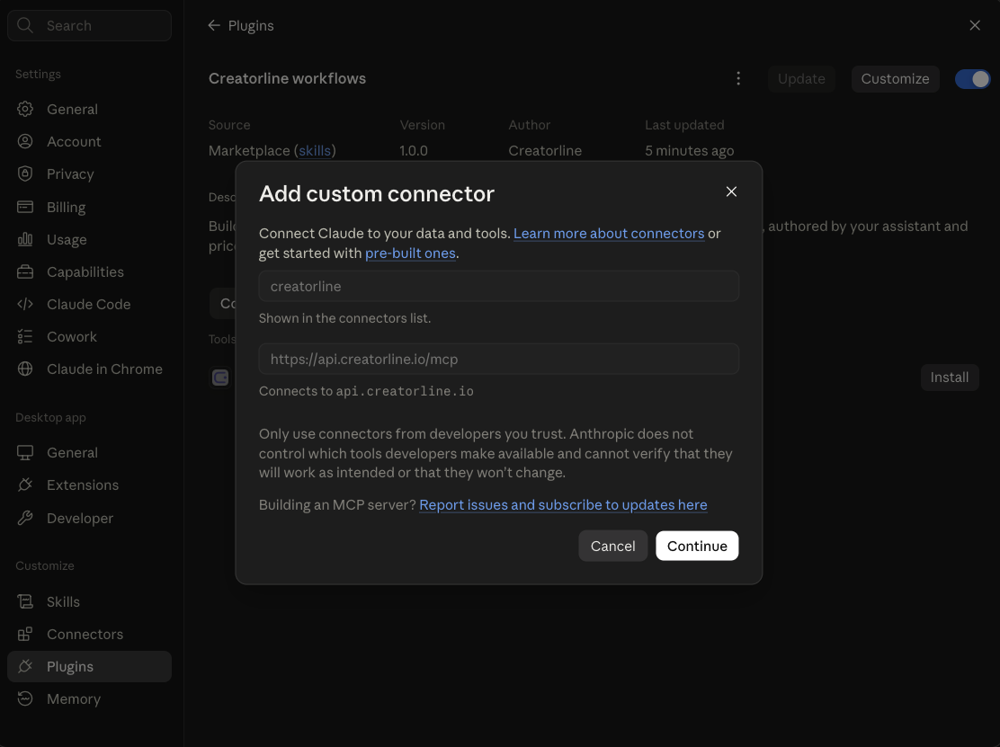
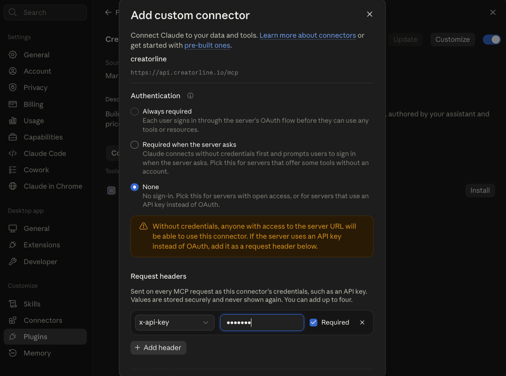

# Creatorline for your AI assistant

Say what you want to post. Your assistant makes it with your AI avatar, tells you what it will
use before anything runs, and leaves the post in your review queue.

Creatorline turns AI avatars (a face, a voice and a persona per brand) into short vertical
videos and photos for social media. This package gives your assistant the Creatorline
connection and a skill for each kind of content, so you describe the result instead of
learning a tool. It works in Claude, ChatGPT, Codex and any assistant that loads skills and
connects to an MCP server.

## Things to ask for

- *"Make a 15 second video of my avatar reviewing this serum, hook in the first second."*
- *"Reshoot this TikTok with my avatar and my product."*
- *"Bu videodaki iki kişiyi avatarlarımla değiştir."* (swap the two people in this video)
- *"Turn my best video into five ad variations with new hooks."*
- *"Plan next week's posts for the matcha brand and make the first three."*
- *"Put word-timed captions on this and write the post."*

Every skill works the same way: it asks only what changes the result, all at once, and says
the defaults it will use for the rest (vertical 9:16, filmed like a phone video). It tells you
the credits a run will use and your balance, and starts only on your yes. While it renders it
keeps you posted, then shows the result with a link that opens it in Creatorline and offers
two or three next steps. Nothing reaches an audience on its own: a post waits in your review
queue until you say when and where it goes out.

## The skills

Start with **Creatorline** (`creatorline`). It orients the assistant in your workspace (brands,
avatars, connected accounts, credits), handles quick one-off photos and clips, and hands off to
the skill that fits.

**Videos with your avatar**

| Skill | What you get |
| --- | --- |
| UGC Talking Video (`creatorline-talking-video`) | Your avatar talks to camera: a review, a hot take, a story, tips. |
| Product Video (`creatorline-product-video`) | The product is the hero, with a voiceover and hands in shot. |
| Unboxing Video (`creatorline-unboxing-video`) | Your avatar opens the package, reveals the product and reacts. |
| Try-On Video (`creatorline-try-on-video`) | Outfits, fit checks and OOTD videos with your avatar. |
| Tutorial Video (`creatorline-tutorial-video`) | A step by step how-to, every step labeled on screen. |
| App Promo Video (`creatorline-app-promo-video`) | Your avatar talks about an app or website while your screenshots show it. |
| AI Host Series (`creatorline-ai-host`) | Longer episodes with your avatar as a recurring host. |
| Faceless Video (`creatorline-faceless-video`) | Narrated videos with no face on camera. |

**From videos that already exist**

| Skill | What you get |
| --- | --- |
| Reshoot a Trend (`creatorline-reshoot`) | A viral video filmed again with your avatar: same beats, same sound. |
| Character Swap (`creatorline-character-swap`) | A real video kept exactly as it is, with one or two people replaced by your avatars. |
| Ad Variations (`creatorline-ad-variations`) | Many versions of one winning video, each changing one thing. |
| Clips from Long Videos (`creatorline-long-to-shorts`) | A podcast or long video cut into captioned vertical shorts. |

**Finishing touches**

| Skill | What you get |
| --- | --- |
| Video Editing (`creatorline-video-studio`) | Cuts, order, text, hooks, sound and layers in Video Studio, then an export. |
| Captions and Hooks (`creatorline-captions`) | Word-timed captions and hook headlines on a video. |
| Voiceover (`creatorline-voiceover`) | Narration fitted to a video, a voice line, a dialogue, or a video re-voiced. |

**Photos**

| Skill | What you get |
| --- | --- |
| Photos and Carousels (`creatorline-photos`) | Avatar photoshoots, product in hand, outfits, and carousels of up to ten photos. |
| Covers and Thumbnails (`creatorline-cover-image`) | A cover with your avatar and a few words that read at small size. |

**Planning and posting**

| Skill | What you get |
| --- | --- |
| Short-Form Script (`creatorline-short-script`) | Hooks and a 15 to 60 second script with beats and on-screen text. Writing only. |
| Content Calendar (`creatorline-content-calendar`) | A week or two of posts worked out from your brand, then made in one batch. |
| Post and Schedule (`creatorline-publish`) | A caption and hashtags in your brand's voice, the accounts and the time. |
| Workflows (`creatorline-workflows`) | Reusable pipelines that make the same kind of content on repeat. |

## Add it to Claude

Four steps, no terminal, no key to copy: you sign in with your Creatorline account.

> Installed the earlier **Creatorline workflows** plugin? It is now part of **Creatorline**.
> Uninstall Creatorline workflows, then install Creatorline once (step 3). Your connection
> and everything in your workspace stay as they are.

### 1. Open Settings → Plugins, then Add → Add marketplace



### 2. Choose "Add from a repository" and paste the address

```text
https://github.com/Creatorline/skills
```



### 3. Install "Creatorline", then press Continue

The plugin brings the connection with it, so the name and address are already filled in.



### 4. Sign in

Claude sees that Creatorline offers a sign-in. Keep the sign-in option selected, sign in to
Creatorline in the window that opens, and approve the access request.

That is it. Ask for something and watch it being made.

The connection acts as you: it reaches the brands you work on in your workspace. If you
belong to several workspaces with brands, Claude gives you a link to a Creatorline page where
you pick the one this connection works in; you pick it once, and nothing has to be installed
again. To disconnect, remove the connector in Claude.

In Claude Code, the same marketplace works from the terminal:

```bash
claude plugin marketplace add Creatorline/skills
claude plugin install creatorline@creatorline
```

Then type `/mcp`, pick `creatorline` and sign in.

<details>
<summary>Use an API key instead</summary>

Under Authentication choose **None**. Under **Request headers**, pick `x-api-key` and paste
a key from [Settings → MCP](https://app.creatorline.io/settings/api). Not every organization
in Claude has the request headers section; if you do not see it, sign in instead.



Claude stores your key and never shows it again. To retire it, revoke that key in
[Settings → MCP](https://app.creatorline.io/settings/api) and add a new one here.

</details>

## Add it to Codex

If Creatorline is in your Codex plugin browser (`/plugins`), install it there: it brings the
skills and the connection together. Otherwise add both yourself:

```bash
npx skills add Creatorline/skills
codex mcp add creatorline --url https://api.creatorline.io/mcp
codex mcp login creatorline
```

The last command opens the browser for the sign-in. Start a new session afterwards so Codex
loads the skills.

## Other assistants and terminal agents

Claude Code, Cursor, Windsurf, VS Code, Zed and other agents take the skills and the server
directly. The skills CLI finds the agents on your machine and installs into each one:

```bash
npx skills add Creatorline/skills                                # choose the skills
npx skills add Creatorline/skills --skill '*'                    # all of them
npx skills add Creatorline/skills --skill creatorline-workflows  # just one
```

Then add the server, `https://api.creatorline.io/mcp` (streamable HTTP), the way your agent
does it, and sign in. In Claude Code:

```bash
claude mcp add --transport http creatorline https://api.creatorline.io/mcp
```

then `/mcp` to sign in. With an API key from
[Settings → MCP](https://app.creatorline.io/settings/api) instead:

```bash
claude mcp add --transport http creatorline https://api.creatorline.io/mcp \
  --header "Authorization: Bearer YOUR_API_KEY"
```

Not sure how your agent adds a server? Paste this into it and it sets itself up:

```text
Fetch and execute the appropriate instructions to set me up for Creatorline from https://creatorline.io/agent-setup/prompt.md
```

## What it sends and what it can do

The skills are instructions; they run nothing on your machine. Everything goes through the
Creatorline MCP server at `https://api.creatorline.io/mcp`, as you, in your workspace: what
you ask for, and the links or library media you point it at. A run that uses credits starts
only after you say yes to its price. Posting to a social account happens only when you say
which post, which accounts and when. Creating brands and avatars, connecting social accounts,
trends, analytics and billing stay in the [Creatorline app](https://app.creatorline.io).

More: [the MCP server guide](https://docs.creatorline.io/mcp-server).

## License

MIT, see [LICENSE](LICENSE). Some skills adapt MIT-licensed material from other projects;
[NOTICE.md](NOTICE.md) credits them. Adding or changing a skill: [CONTRIBUTING.md](CONTRIBUTING.md).
